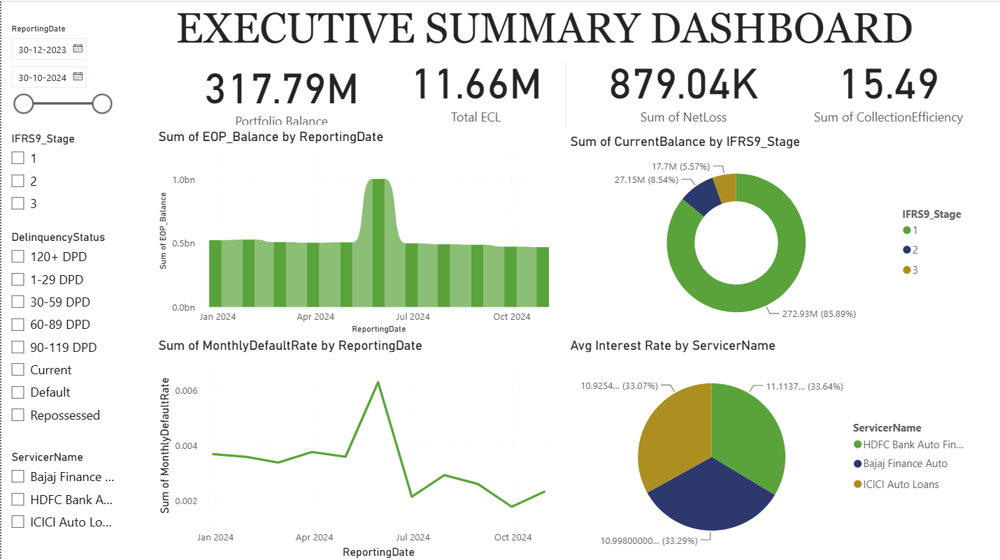
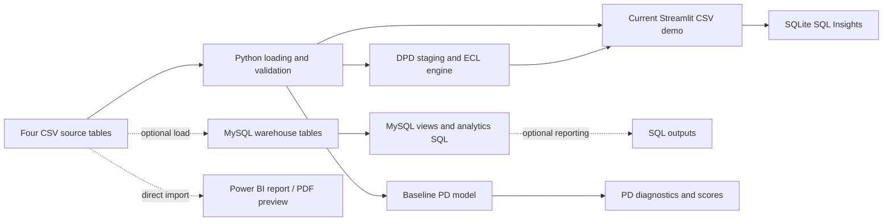

# 🏦 Banking Risk Analytics Suite

> A reproducible portfolio project for a synthetic securitised auto-loan portfolio, combining a Streamlit dashboard, optional MySQL warehouse patterns, baseline PD modeling, IFRS 9-style risk analysis, and Power BI reporting.

[](https://www.python.org/)
[](https://streamlit.io/)
[](https://www.mysql.com/)
[](https://scikit-learn.org/)
[](https://powerbi.microsoft.com/)
[](https://github.com/Vishal123-tech/Banking-Risk-Analytics-Platform-/actions/workflows/ci.yml)

**Live demo:** [Open the Streamlit dashboard](https://n4dmtn9tondqgarhqhzkbn.streamlit.app/) · For local setup, see [RUN_INSTRUCTIONS.md](RUN_INSTRUCTIONS.md).


The live app includes a sidebar page selector, interactive portfolio slicers, calculated ECL, weighted stress testing, CSV export, data-quality checks, and a **SQL Insights** page backed by in-memory SQLite queries.

## Scope and data disclaimer

This is a synthetic, generic ABS-style auto-loan simulation. It uses Indian-style borrower fields such as INR and CIBIL scores alongside broadly used securitisation concepts such as servicers, repossession, waterfall cash flow, CPR, and stress scenarios. It is not a jurisdiction-specific RBI/Ind AS 109 implementation, a regulatory capital model, or a production credit decision system.

The checked-in sample contains 500 loans, 6,000 DPD snapshots, 12 monthly loss observations, and 375 vintage observations. The small sample is useful for demonstrating engineering and analytics patterns, but it is too small for production model validation.

## What is working today

- The Streamlit application reads the four checked-in CSV files directly and runs without a database connection.
- The MySQL folder is an optional warehouse implementation path with DDL, views, indexes, CTEs, window functions, and analytical queries.
- The baseline PD script uses origination-time features, 3-fold stratified out-of-fold evaluation, calibration diagnostics, and coefficient-based feature importance.
- The ECL engine derives DPD-based stages and calculates capped `PD × LGD × EAD × lifetime multiplier` values.
- The SQL Insights page runs real SQLite queries against the currently filtered portfolio and DPD snapshots.
- The Power BI report and screenshot gallery provide management-style reporting examples.

## Dashboard experience

| Dashboard | Decision support |
| --- | --- |
| Executive Summary | Portfolio balance, ECL, net loss, collection efficiency, and headline trends |
| Portfolio Overview | CIBIL, LTV, borrower, vehicle, and regional exposure |
| IFRS-9 | Stage exposure, provisions, and stage-level pricing indicators |
| DPD & Roll Rate | 30+/60+/90+ DPD exposure and prior-to-current delinquency transitions |
| Vintage | Cohort loss curves, pool factor, recoveries, and remaining balance |
| Dynamic Loss | Monthly gross loss, net loss, CPR, recoveries, and excess spread |
| Waterfall | Collections, recoveries, fees, principal, interest, and residual cash flows |
| Investor Reporting | Portfolio balance, 30+ DPD exposure, vintage losses, and cash-flow views |
| Stress Testing | Illustrative base, recession, COVID, and 2008 sensitivity scenarios |
| SQL Insights | In-memory SQLite queries for modeled ECL, high-risk servicers, and DPD roll rates |

Use the **Dashboard page** selector in the sidebar to move between all ten report pages. Interactive filters cover reporting date, DPD-based model stage, delinquency status, servicer, CIBIL score, and number format. The sidebar also includes filtered-loan CSV export and a data-quality snapshot.

## Screenshot gallery

Representative screenshots are stored in documentation/screenshots for browser-viewable previews:

| Streamlit DPD & Roll Rate | Power BI Executive Summary |
| --- | --- |
|  |  |

The supporting simulation screens have a clear three-step purpose:

1. **Scenario Arena:** choose the stress context.
2. **Scenario Brief:** review the mission, portfolio impact, and available analyses.
3. **Decision Centre:** choose a risk-management response and review the recommended analysis path.

The PBIX report requires Power BI Desktop; the screenshots provide a lightweight preview for GitHub visitors.

For a printable preview, open powerbi/Securitisation_Risk_Analytics_screenshot_preview.pdf.

## Key findings from the checked-in sample

- Under the DPD-based staging policy, Stage 1 represents 80.71% of current balance, Stage 2 represents 4.95%, and Stage 3 represents 14.34%; Stage 2 plus Stage 3 therefore accounts for 19.29% of current balance.
- The largest direct worsening transition in the DPD matrix is Current → 1–29 DPD at 10.00%; 1–29 DPD → 60–89 DPD is 8.38% and 30–59 DPD → 60–89 DPD is 8.25%.
- Calculated base ECL is ₹8.74 Cr. With the capped per-loan stress calculation, the illustrative 2008 Crisis ECL rises to ₹15.31 Cr, a 75.28% increase. A 50% Base / 20% Mild / 15% Severe / 10% COVID / 5% 2008 scenario mix produces weighted ECL of ₹10.18 Cr.
- The checked-in sample contains 42 default events out of 500 loans, an observed default rate of 8.4%.

## Baseline PD model

The repository includes risk_modeling/pd_model.py, a reproducible logistic-regression baseline for default classification.

### Engineering choices

- Uses origination-time information such as origination CIBIL score, income, DTI, LTV, loan amount, term, rate, borrower profile, vehicle type, channel, and region.
- Excludes current delinquency, loss, ECL, and default-outcome fields from the feature set to reduce target leakage.
- Handles missing values, scales numeric features, one-hot encodes categorical features, and fits a regularized logistic regression.
- Uses a fixed random seed of 42 and 3-fold stratified out-of-fold predictions.

### Sample diagnostics

| Metric | Result |
| --- | ---: |
| Rows | 500 |
| Default events | 42 |
| Out-of-fold AUC | 0.7252 |
| Out-of-fold KS | 0.3903 |
| Mean predicted PD | 0.0836 |
| Observed default rate | 0.0840 |
| Brier score | 0.0756 |
| Calibration absolute error | 0.0004 |

The synthetic generator derives the default label from CIBIL, DTI, LTV, and a random noise term by construction, so this result demonstrates recovery of a known simulated signal rather than production predictive power. The sample is still small and synthetic; the AUC is a reproducible modeling diagnostic, not a validated credit scorecard.

Run it with:

```bash
python risk_modeling/pd_model.py
```

The script writes metrics, loan-level PD scores, and `pd_feature_importance.csv` to `outputs/pd_model`. The largest absolute coefficients in the checked-in run are CIBIL score, West region, SUV vehicle type, LTV, and DTI. Coefficients are diagnostic model signals, not causal effects.

## Simplified IFRS 9 and stress assumptions

The dashboard calculates its own modeled ECL from the supplied synthetic PD, LGD, and EAD inputs. It does not display `ECL_Provision` as if it were independently calculated. The transparent engine in `risk_modeling/ecl_engine.py` applies:

```text
Stage 1: 12-month PD × LGD × EAD × 1.0
Stage 2: 12-month PD × LGD × EAD × 2.0 illustrative lifetime factor
Stage 3: 12-month PD × LGD × EAD × 3.0 illustrative lifetime factor
```

The staging policy is explicit:

- `DelinquencyDays < 30` → Stage 1.
- `30 ≤ DelinquencyDays < 90` → Stage 2.
- `DelinquencyDays ≥ 90`, Default, or Repossessed → Stage 3.
- PD and LGD are clipped to `[0, 1]` before ECL is calculated.

This remains intentionally simplified. It does not implement:

- Discounting of expected cash shortfalls at the effective interest rate.
- Calibrated transition matrices, PIT/TTC PDs, or regulatory capital treatment.

The scenario multipliers and weights are illustrative sensitivity assumptions, not calibrated macroeconomic probabilities. Stress ECL is calculated per loan with PD and LGD caps, then weighted across scenarios:

```text
Stress ECL = capped PD × capped LGD × EAD × lifetime multiplier
Weighted ECL = Σ(Scenario ECL × Scenario Weight) / Σ(Selected Weights)
```

| Scenario | PD multiplier | LGD multiplier | Weight |
| --- | ---: | ---: | ---: |
| Base | 1.00× | 1.00× | 50% |
| Mild Recession | 1.25× | 1.10× | 20% |
| Severe Recession | 1.50× | 1.30× | 15% |
| COVID Shock | 1.80× | 1.20× | 10% |
| 2008 Crisis | 2.00× | 1.50× | 5% |

## Architecture and data flow



The solid paths are the currently working Streamlit, SQLite, PD, and calculated-ECL routes. The dotted path is the optional MySQL implementation route; the current Streamlit app does not query MySQL directly.

## Reproducibility

Generate a fresh synthetic portfolio without overwriting the checked-in sample:

```bash
python data/generate_synthetic_portfolio.py --seed 42 --output-dir data/generated
```

The generator creates 500 loans, 6,000 snapshots, 12 monthly loss rows, and 375 vintage rows by default. The fixed seed makes the generated sample repeatable.

## SQL scope

The app uses SQLite in memory for the live **SQL Insights** page, so the repository can execute real SQL without database setup. The separate MySQL folder remains an optional warehouse-pattern implementation:

- create_tables.sql — warehouse table definitions.
- indexes.sql — query-performance indexes.
- views.sql — reusable portfolio and IFRS 9 views.
- ctes.sql — high-risk loan analysis with CTEs.
- window_functions.sql — rankings and running metrics.
- stored_procedures.sql — refresh procedure example.
- banking_analytics.sql — portfolio-level queries.
- ifrs9_analytics.sql — ECL and stage analysis.
- roll_rate_analytics.sql — DPD transition analysis.
- vintage_analytics.sql — cohort performance.
- collection_analytics.sql — collections and recoveries.
- stress_testing_framework.sql — scenario sensitivity analysis.

The live SQL page exposes three query outputs: modeled ECL by DPD-based stage, high-risk servicer exposure, and DPD roll-rate transitions. The MySQL scripts remain available for warehouse-oriented patterns such as DDL, views, CTEs, window functions, and stored procedures.

## Data-quality approach

The application and tests cover:

- Required file availability and schema checks.
- Date parsing and standardized reporting dates.
- Duplicate LoanID detection.
- Missing-value snapshots.
- Filter-aware portfolio calculations.
- DPD-based staging, PD/LGD caps, and calculated ECL arithmetic.
- Per-loan stress caps and probability-weighted scenario ECL.
- Leakage-aware PD feature selection.
- Reproducible synthetic-data generation.

## Reproduce and test locally

```powershell
python -m venv .venv
.\\.venv\\Scripts\\Activate.ps1
pip install -r requirements-dev.txt
python -m streamlit run app.py
pytest -q
```

The repository also includes a GitHub Actions workflow that compiles the Python files and runs pytest on pushes and pull requests.

## Repository structure

```text
Banking-Risk-Analytics-Platform-/
├── app.py
├── data/
│   ├── auto_loan_securitisation_data.csv
│   ├── dpd_snapshot_history.csv
│   ├── dynamic_loss_monthly.csv
│   ├── static_pool_vintage_data.csv
│   └── generate_synthetic_portfolio.py
├── risk_modeling/
│   ├── pd_model.py
│   └── ecl_engine.py
├── etl/                              # Extract, load, validation, and connection utilities
├── sql/                              # Optional MySQL warehouse and analytics scripts
├── documentation/
│   ├── data_dictionary.md
│   ├── warehouse_architecture.md
│   ├── advanced_sql_features.md
│   ├── stress_testing_framework.md
│   └── screenshots/
├── powerbi/
│   ├── Securitisation_Risk_Analytics.pbix
│   ├── Securitisation_Risk_Analytics_screenshot_preview.pdf
│   └── README.md
├── tests/
├── .github/workflows/ci.yml
├── requirements.txt
├── requirements-dev.txt
├── RUN_INSTRUCTIONS.md
└── LICENSE
```

## One-page case study

### Problem

Risk and operations users need a repeatable way to identify delinquency migration, provisioning pressure, portfolio concentration, and stress sensitivity in a securitised auto-loan portfolio. The checked-in data is synthetic, so the objective is to demonstrate an auditable analytics workflow rather than claim production credit performance.

### Approach

The platform validates four CSV sources, scores default risk with a leakage-aware logistic-regression baseline, derives DPD-based IFRS 9-style stages, calculates capped per-loan ECL, runs weighted stress scenarios, and exposes the same filtered data through Streamlit charts and SQLite queries. Power BI screenshots provide a management-reporting view.

### Three findings

1. Stage 2 and Stage 3 account for 19.29% of current balance under the explicit DPD-based staging policy.
2. The largest direct worsening transition is Current → 1–29 DPD at 10.00%; 1–29 DPD → 60–89 DPD is 8.38%.
3. Calculated base ECL of ₹8.74 Cr increases to ₹15.31 Cr under the illustrative 2008 Crisis scenario; the weighted five-scenario ECL is ₹10.18 Cr.

### Three recommendations

1. Prioritize early-warning collections for Current → 1–29 DPD and 1–29 DPD → 60–89 DPD transitions before accounts reach Stage 3.
2. Use the modeled Stage 2/3 exposure and servicer-level SQL output to focus portfolio reviews on concentrated risk and provisioning pressure.
3. Use the weighted stress ECL as a planning baseline, then replace illustrative weights with calibrated macroeconomic scenario probabilities before production use.

## Power BI measure reference

The report is distributed as a `.pbix` plus a static PDF preview. These are the core DAX measures used for the management views; table names can be remapped to the model tables when opening the PBIX:

```DAX
Portfolio Balance = SUM(Loans[CurrentBalance])
Reported ECL = SUM(Loans[ECL_Provision])
Net Loss = SUM(Loans[NetLoss])
30+ DPD Exposure = CALCULATE([Portfolio Balance], Loans[DelinquencyDays] >= 30)
Stage 2 and 3 Exposure = CALCULATE([Portfolio Balance], Loans[IFRS9_Stage] IN { 2, 3 })
Collection Efficiency = AVERAGE(Loss[CollectionEfficiency])
```

## Business impact

The project supports risk and operations teams by helping them:

- Prioritize collection review using DPD transitions and high-risk exposures.
- Identify provisioning pressure under illustrative stress scenarios.
- Compare portfolio quality across IFRS 9 stages, servicers, regions, and vintages.
- Review cash-flow waterfall performance and investor-facing portfolio trends.
- Move from descriptive reporting toward reproducible, testable risk analytics.

## Limitations and next steps

- Replace synthetic fields with observed loan-level performance and macroeconomic history.
- Build a larger default sample and recalibrate the PD model before interpreting AUC/KS.
- Connect the Streamlit app to a production-style warehouse layer such as MySQL or PostgreSQL.
- Replace the illustrative lifetime multipliers with discounted cash-shortfall ECL and calibrated macroeconomic scenario probabilities.
- Align the policy framing to a selected jurisdiction, such as RBI/Ind AS 109, if the project is presented as India-specific.
- Add a native Power BI PDF export after opening the PBIX in Power BI Desktop.

## License

MIT License. The data in this repository is synthetic and generated by `data/generate_synthetic_portfolio.py`.

## Author

**Vishal Yadav**

[GitHub profile](https://github.com/Vishal123-tech) · [Project repository](https://github.com/Vishal123-tech/Banking-Risk-Analytics-Platform-)
