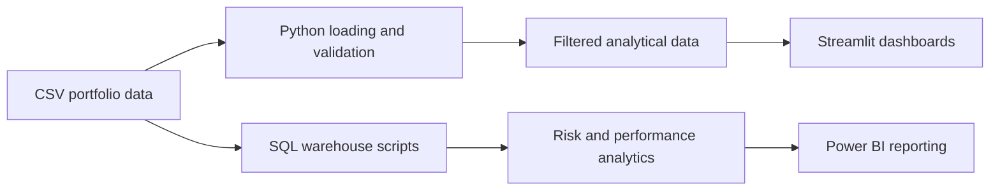

# 🏦 Banking Risk Analytics Platform

> An end-to-end analytics platform for securitised auto-loan portfolios, combining Python, SQL, IFRS 9 risk metrics, interactive Streamlit dashboards, and Power BI reporting.

[](https://www.python.org/)
[](https://streamlit.io/)
[](https://www.mysql.com/)
[](https://powerbi.microsoft.com/)
[](https://github.com/Vishal123-tech/Banking-Risk-Analytics-Platform-)

## Overview

This project simulates a real-world banking risk analytics workflow for a securitised auto-loan portfolio. It turns raw loan, delinquency, loss, and vintage data into decision-ready views for portfolio monitoring, expected credit loss analysis, collections, investor reporting, and stress testing.

The repository includes:

- A nine-page Streamlit dashboard with responsive Plotly charts.
- A reusable Python data-loading and filtering layer.
- SQL scripts for warehouse tables, views, indexes, CTEs, window functions, and procedures.
- ETL and data-quality utilities.
- A Power BI report for executive and risk reporting.
- Documentation covering the warehouse architecture, data dictionary, and stress-testing framework.

## Business questions answered

- How healthy is the current securitised portfolio?
- How is exposure distributed across IFRS 9 Stages 1, 2, and 3?
- Which delinquency buckets and transitions require attention?
- How do loan vintages perform as months-on-book increase?
- What are the current loss, recovery, collection, and excess-spread trends?
- How does expected credit loss change under recession and shock scenarios?
- Which portfolio views are most useful for risk, collections, investors, and management?

## Dashboard experience

| Dashboard | What it highlights |
| --- | --- |
| Executive Summary | Portfolio balance, ECL, net loss, collection efficiency, and headline trends |
| Portfolio Overview | CIBIL distribution, LTV exposure, borrower profile, and regional views |
| IFRS-9 | Stage exposure, ECL provisions, and stage-level pricing metrics |
| DPD & Roll Rate | 30+/60+/90+ DPD exposure, delinquency migration, and roll-rate matrix |
| Vintage | Cohort loss curves, recoveries, pool factor, and remaining balance |
| Dynamic Loss | Monthly loss, CPR, collection efficiency, and balance movement |
| Waterfall | Collections, recoveries, fees, principal, interest, and residual cash flows |
| Investor Reporting | Balance trends, 30+ DPD exposure, vintage losses, and cash-flow views |
| Stress Testing | Base, mild, severe, COVID shock, and 2008 crisis ECL scenarios |

All dashboards share interactive filters for reporting date, IFRS 9 stage, delinquency status, servicer, CIBIL score, and number format. The sidebar also provides a filtered-loan CSV export and a compact data-quality snapshot.

## Architecture



## Analytics included

### Credit risk and IFRS 9

- Probability of Default (PD), Loss Given Default (LGD), and Exposure at Default (EAD).
- Expected Credit Loss (ECL) analysis using the formula ECL = PD × LGD × EAD.
- Stage 1, Stage 2, and Stage 3 portfolio segmentation.
- High-risk loan, state, servicer, and exposure analysis.

### Delinquency and collections

- DPD bucket monitoring from current through default and repossession.
- Prior-to-current delinquency transition matrix.
- Cure, roll-forward, write-off, and repossession indicators.
- Collections, recoveries, collection efficiency, and excess-spread analysis.

### Portfolio performance

- Vintage and months-on-book cohort curves.
- Pool factor, cumulative net loss, remaining balance, and recovery trends.
- Cash-flow waterfall analysis across collections, fees, interest, principal, and residual distribution.

### Stress testing

The dashboard applies transparent PD and LGD multipliers to the selected portfolio:

| Scenario | PD multiplier | LGD multiplier |
| --- | ---: | ---: |
| Base | 1.00× | 1.00× |
| Mild Recession | 1.25× | 1.10× |
| Severe Recession | 1.50× | 1.30× |
| COVID Shock | 1.80× | 1.20× |
| 2008 Crisis | 2.00× | 1.50× |

## Data included

| File | Purpose | Rows in current sample |
| --- | --- | ---: |
| auto_loan_securitisation_data.csv | Loan, borrower, vehicle, credit, balance, and IFRS 9 fields | 500 |
| dpd_snapshot_history.csv | Monthly DPD snapshots, transitions, cures, repossessions, and write-offs | 6,000 |
| dynamic_loss_monthly.csv | Monthly balances, losses, recoveries, collections, and rates | 12 |
| static_pool_vintage_data.csv | Vintage-level performance across months on book | 375 |

The files are synthetic portfolio data intended for analytics demonstration and portfolio-project use.

## Technology stack

- Python, pandas, NumPy, Plotly, and Streamlit.
- MySQL-compatible SQL for warehouse and analytical patterns.
- Power BI for management and investor reporting.
- Git and GitHub for version control.

## Repository structure

```text
Banking-Risk-Analytics-Platform-master/
├── app.py                              # Streamlit dashboard application
├── requirements.txt                    # Python dependencies
├── RUN_INSTRUCTIONS.md                 # Local and Streamlit deployment guide
├── data/                               # Synthetic portfolio CSV files
├── documentation/
│   ├── data_dictionary.txt             # Core dimensions and facts
│   ├── warehouse_architecture.txt      # Raw, staging, dimension, and fact layers
│   ├── advanced_sql_features.txt       # Views, indexes, CTEs, windows, procedures
│   └── stress_testing_framework.txt    # Scenario and impact framework
├── etl/                                # Extract, validation, and load utilities
├── sql/                                # Warehouse DDL and risk analytics queries
└── powerbi/
    └── Securitisation_Risk_Analytics.pbix
```

## Run locally

### 1. Clone the repository

```bash
git clone https://github.com/Vishal123-tech/Banking-Risk-Analytics-Platform-.git
cd Banking-Risk-Analytics-Platform-
```

### 2. Create an environment and install dependencies

```bash
python -m venv .venv
```

Windows PowerShell:

```powershell
.\\.venv\\Scripts\\Activate.ps1
```

macOS/Linux:

```bash
source .venv/bin/activate
```

```bash
pip install -r requirements.txt
```

### 3. Start the dashboard

```bash
streamlit run app.py
```

Streamlit will open the dashboard in your browser. Keep the repository structure intact so the app can find the four files in data/.

## SQL and ETL workflow

The SQL folder is organized so the project can be extended from a CSV demo into a warehouse-backed implementation:

1. Create warehouse tables with sql/create_tables.sql.
2. Add indexes and reusable views.
3. Load or transform data with the utilities in etl/.
4. Run portfolio, IFRS 9, roll-rate, vintage, collection, and stress-testing queries.
5. Connect the resulting tables or views to Power BI.

The SQL examples demonstrate views, CTEs, window functions, stored procedures, and indexes rather than relying only on dashboard calculations.

## Data-quality approach

The project demonstrates practical checks for:

- Missing files and required columns.
- Date parsing and standardized reporting dates.
- Duplicate loan and snapshot records.
- Numeric and categorical field consistency.
- Filter-aware portfolio calculations.
- Transparent stress-test assumptions.

## Important assumptions

- ECL stress results are scenario-analysis outputs, not regulatory capital advice.
- The included data is synthetic and does not represent any real borrower, bank, lender, or securitisation trust.
- The Power BI report requires Microsoft Power BI Desktop to open.
- MySQL is optional for the Streamlit demo; the dashboard reads the included CSV files directly.

## Why this project matters

This portfolio project demonstrates the complete path from raw financial data to business insight: data quality, warehouse thinking, credit-risk metrics, delinquency movement, loss forecasting, stress testing, and executive-ready reporting.

## Author

**Vishal Yadav**

[GitHub profile](https://github.com/Vishal123-tech) · [Project repository](https://github.com/Vishal123-tech/Banking-Risk-Analytics-Platform-)
