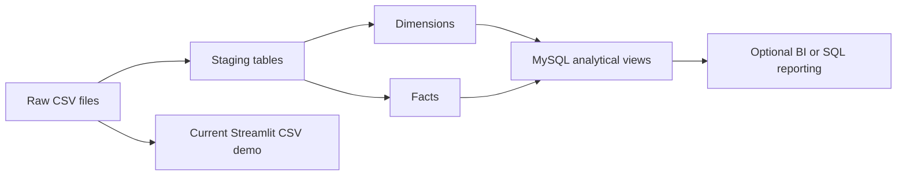

# Banking Risk Data Warehouse Architecture

## Raw data

- auto_loan_securitisation_data
- dpd_snapshot_history
- dynamic_loss_monthly
- static_pool_vintage_data

## Staging layer

- stg_auto_loan_securitisation_data
- stg_dpd_snapshot_history
- stg_dynamic_loss_monthly
- stg_static_pool_vintage_data

## Dimensions

- DimBorrower
- DimVehicle
- DimRegion
- DimIFRSStage
- DimDate

## Facts

- FactLoanPerformance
- FactDPDHistory
- FactVintagePerformance

## Implementation status

The Streamlit dashboard currently reads the checked-in CSV files directly. The SQL folder is an optional MySQL implementation path containing warehouse DDL and analytical query patterns; it is not yet the data source for the Streamlit app.
